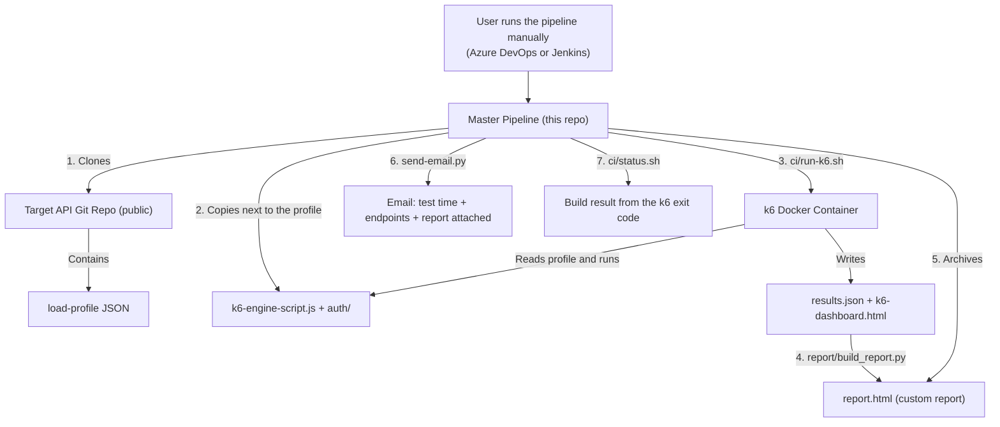
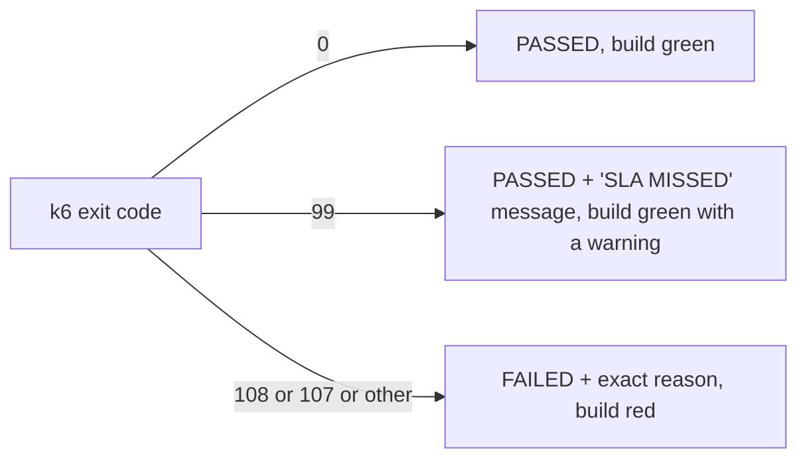

# Master Performance Testing Pipeline

A reusable, manually triggered CI/CD performance testing architecture for **Azure DevOps** and **Jenkins**, built on **Grafana k6**.

This architecture separates the **master pipeline logic** (this repository) from the **API-specific load configurations** (the API source repositories). Any API can be load tested simply by committing a load-profile JSON file in the API's repository and running this pipeline against it.

| Document | What it covers |
|---|---|
| **README.md** (this file) | Details and architecture of the application |
| [PREREQUISITES.md](PREREQUISITES.md) | What is needed to run it |
| [INSTALLATION-STEPS.md](INSTALLATION-STEPS.md) | Step-by-step setup for Azure DevOps, Jenkins and email |

---

## Architecture Overview



1. **The Master Pipeline Repo (this repo)**: contains both CI front ends (`azure-pipelines.yml` + `k6-pipeline-job-template.yml`, and `Jenkinsfile`), the generic k6 engine, the pluggable auth modules, the report builder and the email sender.
2. **The API Repository**: contains only the load-profile JSON describing its endpoints, methods (including standard verbs and `QUERY`), headers, payloads, authentication, stages and thresholds. It needs **no pipeline YAML** in manual mode.
3. **Execution**: the pipeline clones the API repo, places the generic engine next to the profile, runs the official `grafana/k6` container, builds one self-contained HTML report, archives it, emails it and sets the build result.

> [!NOTE]
> **The rule that keeps both CI tools working:** the engine and the scripts under `ci/` know nothing about Azure DevOps or Jenkins. Each CI tool only maps its own secret store onto the environment variables listed in section 6. Change a shared file once and both tools get the change.

---

## 1. Repository Layout

| Path | Used by | Purpose |
|---|---|---|
| `azure-pipelines.yml` | Azure DevOps | The pipeline you create in ADO (manual, `trigger: none`). Holds the run parameters. |
| `k6-pipeline-job-template.yml` | Azure DevOps | The reusable job: clone, run k6, build the report, archive, email, decide the build result. |
| `Jenkinsfile` | Jenkins | The pipeline you create in Jenkins (**Pipeline script from SCM**). Same steps as above. |
| `k6-engine-script.js` | both | Generic k6 runner. Reads the profile JSON and resolves `{{VAR}}` tokens from environment variables. |
| `auth/` | both | Pluggable authentication: OAuth 2.0 client credentials, client ID enforcement, Basic. |
| `ci/run-k6.sh` | both | The one place that holds the `docker run` command and the list of credential variables passed to k6. |
| `ci/status.sh` | both | The one rule that turns a k6 exit code into `PASSED` / `FAILED` and the one-line reason (build log and report; the email does not state the result). |
| `report/` | both | `build_report.py` and `report-template.html`: the custom report. |
| `send-email.py` | both | SMTP sender (test time, endpoint list and the report attached; no result label). |
| `templates/` | API teams | Starter files only (nothing runs from here): example profiles, `azure-pipelines.yml`, `azure-pipelines-api-repo.yml` and a `Jenkinsfile` (section 3). The pipeline you run is the root `azure-pipelines.yml`. |
| `run-local.sh`, `run-local.ps1`, `local-run/` | developers | Run a profile on your own machine (not part of the CI flow). |

---

## 2. How a Run Works

```
Run with parameters
  -> checkout this tooling repo
  -> clone the API repo (apiRepoUrl)
  -> copy k6-engine-script.js + auth/ next to the profile
  -> ci/run-k6.sh : grafana/k6 in Docker -> k6-dashboard.html + results.json (inputs of the report), exit code
  -> report/build_report.py : results.json + the time series in k6-dashboard.html -> report.html
  -> archive report.html (Azure: artifact "StressTestReport", Jenkins: build artifact). It is the only email attachment
  -> ci/status.sh + send-email.py : email the report
  -> final check: decide the build result from the k6 exit code
```

### Run parameters (same names in both tools)

| Parameter | Meaning |
|---|---|
| `apiRepoUrl` | Git URL of the repo that holds the profile (default: `https://github.com/AnkitProwess/sample-api.git`). |
| `apiName` | Folder in the API repo, case-sensitive (empty = repo root). **Not** the `apiName` label inside the JSON. |
| `profileName` | JSON file name inside that folder, e.g. `load-profile3.json`. |
| `reportRecipient` | Who receives the email, comma or semicolon separated. |
| `reportCc` | Optional Cc addresses. No Cc by default: Jenkins leaves it empty, Azure DevOps uses `none` (an empty default would make Azure show the field as required). An address already in `reportRecipient` is not repeated. |
| `debug` | `true` adds `k6 --http-debug=full`. It writes request headers, **including credentials and tokens**, to the log. Use only when needed. |
| Jenkins only: `apiRepoBranch`, `apiRepoCredentialsId` | Branch to clone (default `main`); credentials ID for a private API repo. |

> [!NOTE]
> **The API repo to be tested must be public** when you run the pipeline by URL (manual mode), because the pipeline clones it anonymously. Each team keeps its own API repo wherever it likes and passes that URL as `apiRepoUrl`; the sample API used to test this tooling is likewise a separate repo. The local `sample-api/` folder next to this repo is only a reference copy.
> Never put real secrets in a public repo: profiles reference credentials through `{{NAME}}` tokens that the pipeline fills from its own secret store (section 6). Private API repos need extra credential setup (see [INSTALLATION-STEPS.md](INSTALLATION-STEPS.md)).

---

## 3. Setting Up the Target API Repository

Add a load profile (e.g. `load-profile.json`) either at the root of the API repository or inside a dedicated folder (e.g. `mule-employees-xapi/load-profile.json`). Folders let one repository hold the profiles of several APIs; the folder name is the `apiName` run parameter.

The `endpoints` array is executed in order by every virtual user (VU) in each iteration. `{{NAME}}` tokens in the profile are replaced with the environment variable `NAME`.

### Option A: Basic Load Profile (Endpoint Collection)

```json
{
  "apiName": "PaymentGateway-StressTest",
  "stages": [
    { "duration": "10s", "target": 5 },
    { "duration": "20s", "target": 10 },
    { "duration": "10s", "target": 0 }
  ],
  "endpoints": [
    {
      "endpoint": "https://httpbin.org/post",
      "method": "POST"
    }
  ]
}
```

### Option B: Advanced Load Profile (Custom Headers, Payloads and SLAs)

For complex request collections (including GraphQL or API queries using the `QUERY` method), custom headers, pacing/sleep and custom thresholds (SLAs):

```json
{
  "apiName": "OrderQuery-PerformanceTest",
  "artifact_version": "1.0.0",
  "stages": [
    { "duration": "10s", "target": 5 },
    { "duration": "20s", "target": 15 },
    { "duration": "10s", "target": 0 }
  ],
  "thresholds": {
    "http_req_failed": ["rate<0.005"],
    "http_req_duration": ["p(90)<500", "p(95)<1000", "p(99)<2000"]
  },
  "endpoints": [
    {
      "endpoint": "https://httpbin.org/anything",
      "method": "QUERY",
      "headers": {
        "Content-Type": "application/json",
        "X-Client-Id": "stress-test-agent"
      },
      "payload": {
        "query": "query GetActiveOrders($limit: Int) { orders(status: ACTIVE, limit: $limit) { id amount customer { name } } }",
        "variables": { "limit": 100 }
      },
      "expectedStatus": 200,
      "sleepDuration": 0.5
    }
  ]
}
```

### Option C: Authenticated Profile (OAuth 2.0 Client Credentials)

Secrets are never written in the profile. The `{{...}}` tokens are filled from the CI tool's secret store (section 6):

```json
{
  "apiName": "AI Innovation POC1 API",
  "artifact_version": "1.0.105",
  "authType": "OAUTH2_CLIENT_CREDENTIALS",
  "authParameters": {
    "tokenUrl": "{{OAUTH_TOKEN_URL}}",
    "clientId": "{{OAUTH_CLIENT_ID}}",
    "clientSecret": "{{OAUTH_CLIENT_SECRET}}",
    "scope": "{{OAUTH_SCOPE}}",
    "grantType": "client_credentials"
  },
  "stages": [ { "duration": "10s", "target": 15 }, { "duration": "10s", "target": 0 } ],
  "thresholds": { "http_req_failed": ["rate<0.01"], "http_req_duration": ["p(95)<2000"] },
  "endpoints": [
    { "endpoint": "https://example.cloudhub.io/api/orders/ORD102", "method": "GET", "expectedStatus": 200, "sleepDuration": 0.5 }
  ]
}
```

### Profile field reference

| Field | Level | Meaning |
|---|---|---|
| `apiName`, `artifact_version` | root | Labels for the email subject only (`artifact_version` is typed by hand, default `N/A`). |
| `stages` | root | k6 ramping stages (`duration`, `target` VUs). |
| `thresholds` | root | k6 thresholds (the SLA). Default: `http_req_failed rate<0.01`, `http_req_duration p(95)<2000`. |
| `authType`, `authParameters` | root or endpoint | Authentication (section 6). An endpoint's own value overrides the root; `"authType": "NONE"` opts out. |
| `probe` | root, optional | `"auto"` (default), `"all"` or `"off"`: how the credential probe works (section 8). |
| `method` | endpoint | HTTP verb, including `QUERY`. Default `GET`. |
| `payload` | endpoint | Object or string, for POST / PUT / PATCH / QUERY. |
| `headers` | endpoint | Request headers. |
| `expectedStatus` | endpoint | Number or list (e.g. `[200, 409]`), default `200`. The profile decides what a success is. |
| `sleepDuration` | endpoint | Pause in seconds after the call. Default `1`. |
| `name` | endpoint, optional | Label used in checks and logs (default: `METHOD url`). |
| `readOnly` | endpoint, optional | `true` = safe to call as a credential probe although the method is POST (e.g. a GraphQL query). `false` on a GET = never probe it. |
| `batchGroup` | endpoint, optional | Consecutive endpoints with the same value run in parallel (section 5). |

Starter files in `templates/`. Replace every `<...>` value before use:

| File | Shows | Mirrors |
|---|---|---|
| `load-profile.json` | The minimum: stages and one endpoint (public `httpbin.org`, runs as it is) | - |
| `load-profile-advanced.json` | Client ID authentication (`authType` + `authParameters` with `{{CLIENT_ID}}` / `{{CLIENT_SECRET}}`), stages, three latency thresholds, a GET and a PUT with a payload | `sample-api/AI_innovation_poc1/load-profile6-multi-put-update.json` (profiles 2-6 share this layout) |
| `load-profile-batch.json` | The same authentication, two GETs with the same `batchGroup`, called in parallel | `load-profile7-batch-get.json` |
| `load-profile-smoke.json` | Credential-free parallel batch against `httpbin.org` (light load, 3 virtual users at most). Used for the install check, INSTALLATION-STEPS.md Part 5 | - |
| `azure-pipelines.yml` | Template only, not used by any pipeline: a copy of the manual runner with `<...>` defaults for a team's own tooling repo. The pipeline you run is the root `azure-pipelines.yml` | root `azure-pipelines.yml` |
| `azure-pipelines-api-repo.yml` | Optional, for a team that wants the pipeline inside its own API repo: calls the central job template from there ("imported mode"). The pipeline run from this repo is the root `azure-pipelines.yml` itself | - |
| `Jenkinsfile` | Optional: the API repo's own Jenkins job that triggers the central job with the run parameters | parameters of the root `Jenkinsfile` |

For OAuth or Basic, change the `authType` / `authParameters` block as in section 6 (`load-profile2.json` and `load-profile4.json` in `sample-api/`). The other templates carry no real host on purpose; `sample-api/` is the reference copy of the real profiles.

---

## 4. Using the HTTP `QUERY` Method

The custom HTTP `QUERY` method is supported by the generic engine. It allows safe, idempotent retrievals that carry a request body (common in complex REST queries and GraphQL setups). The engine routes standard verbs and custom ones such as `QUERY` through k6's `http.request()`:

```javascript
res = http.request('QUERY', url, body, params);
```

> [!NOTE]
> For the credential probe (section 8) the engine treats only `GET`, `HEAD` and `OPTIONS` as read-only by default. A `QUERY` or GraphQL `POST` endpoint is treated as a write endpoint unless the profile sets `"readOnly": true` on it.

---

## 5. Parallel / Batch Execution of Endpoints

By default, endpoints run sequentially inside each VU's iteration. To call several endpoints concurrently (for example parallel asset downloads), give consecutive endpoints the same `batchGroup` value. They are executed in parallel with k6's native `http.batch()`.

```json
{
  "apiName": "Parallel-Testing-Collection",
  "stages": [
    { "duration": "10s", "target": 5 },
    { "duration": "10s", "target": 0 }
  ],
  "endpoints": [
    { "endpoint": "https://httpbin.org/get", "method": "GET", "batchGroup": "asset-group-1" },
    { "endpoint": "https://httpbin.org/delay/1", "method": "GET", "batchGroup": "asset-group-1" },
    { "endpoint": "https://httpbin.org/post", "method": "POST", "sleepDuration": 1.0 }
  ]
}
```

In this scenario:
1. `https://httpbin.org/get` and `https://httpbin.org/delay/1` are triggered **concurrently**.
2. Once the batch finishes, the `POST` to `https://httpbin.org/post` runs **sequentially**.
3. The pause after a batch is the largest `sleepDuration` among its members.

---

## 6. Authentication and the Credential Contract

Authentication is pluggable (`auth/`). Each module exports `validate`, `setup` and `apply`, and is registered in `auth/index.js`.

| `authType` | `authParameters` | Effect |
|---|---|---|
| `OAUTH2_CLIENT_CREDENTIALS` | `tokenUrl`, `clientId`, `clientSecret`, `scope`, optional `grantType` (`client_credentials` only) | Token fetched once in `setup()`, sent as `Authorization: Bearer`. |
| `CLIENT_ID_ENFORCEMENT` | `clientId`, `clientSecret` | Sent as `client_id` / `client_secret` headers. |
| `BASIC` | `username`, `password` | `Authorization: Basic base64(user:pass)`. |

One token is fetched per distinct credential set, however many endpoints share it. Old profiles that put `{{CLIENT_ID}}` straight into endpoint headers still work.

### Credential contract (the part that must stay the same)

The engine reads **environment variable names**. The names of the Azure variable groups and Jenkins credential IDs are only storage labels. **Never rename an environment variable for one CI tool**: it would break the other tool and every profile that uses `{{NAME}}`.

| Environment variable | Used by | Azure DevOps (variable group -> variable) | Jenkins (credential ID, type) |
|---|---|---|---|
| `CLIENT_ID`, `CLIENT_SECRET` | `CLIENT_ID_ENFORCEMENT` | `perf-client-id` -> `client_id`, `client_secret` | `perf-client-id` (username with password) |
| `OAUTH_CLIENT_ID`, `OAUTH_CLIENT_SECRET` | `OAUTH2_CLIENT_CREDENTIALS` | `perf-oauth` -> `OAUTH_CLIENT_ID`, `OAUTH_CLIENT_SECRET` | `perf-oauth-client` (username with password) |
| `OAUTH_TOKEN_URL` | `OAUTH2_CLIENT_CREDENTIALS` | `perf-oauth` -> `OAUTH_TOKEN_URL` | `perf-oauth-token-url` (secret text) |
| `OAUTH_SCOPE` | `OAUTH2_CLIENT_CREDENTIALS` | `perf-oauth` -> `OAUTH_SCOPE` | `perf-oauth-scope` (secret text) |
| `BASIC_USERNAME`, `BASIC_PASSWORD` | `BASIC` | `perf-basic-auth` -> `BASIC_USERNAME`, `BASIC_PASSWORD` | `perf-basic-auth` (username with password) |
| `SMTP_USER`, `SMTP_PASSWORD` | email | `perf-smtp` -> `SMTP_USER`, `SMTP_PASS` | `perf-smtp` (username with password) |
| `SMTP_HOST`, `SMTP_PORT`, `SMTP_TLS`, `SMTP_FROM` | email | `perf-smtp` | `environment` block of the `Jenkinsfile` (`SMTP_FROM` defaults to the SMTP user) |
| `MANDATORY_RECIPIENTS` (optional) | email | `perf-smtp` | global environment variable |

Two storage differences, both handled in each CI tool's own mapping (no engine change): Azure stores the OAuth client ID and secret as two variables, Jenkins as one username/password credential; Azure's SMTP password variable is `SMTP_PASS`, which the template maps to `SMTP_PASSWORD`.

If a profile needs a value that was never supplied, or a variable that still holds its raw `{{NAME}}` / `$(name)` text, the engine stops in `setup()` and names the missing key (exit 107).

### Adding a new auth type

1. Add `auth/<name>.js` exporting `validate(authParameters)`, `setup(authParameters)` and `apply(headers, authParameters, state)`.
2. Register it with one line in `auth/index.js`.
3. If it needs **new variables**: add the names to `PASSTHROUGH` in `ci/run-k6.sh`, map the secret in `k6-pipeline-job-template.yml` (`env:`) and in the `Jenkinsfile` (`credentialBindings`), and add a row to the table above.

---

## 7. Results: What the Build and the Report Say

> [!NOTE]
> The **email does not state the result**. It identifies the test (API, date and time, endpoints) and attaches the report. The result lives in the build status, the build log and `report.html`. The labels below are the build / report labels.



| k6 exit | Meaning | Build | Label in the report / build log |
|---|---|---|---|
| `0` | All thresholds met | green | PASSED |
| `99` | The test ran, but an SLA threshold (latency / error rate) was crossed | **green with a warning** (Azure: "succeeded with issues"; Jenkins: yellow stage, build stays SUCCESS) | PASSED with the message **"SLA MISSED: ..."** |
| `108` | The engine **stopped the run**, or the run finished but **an endpoint never succeeded** | **red** | FAILED + the exact reason (report attached when one exists) |
| `107` | The test could not start: setup or script error | **red** | FAILED + the exact reason |
| anything else | The test could not run (Docker error, killed process, ...) | **red** | FAILED + what the exit code proves |

- `FAILED` is reserved for "the test could not run". An SLA miss is shown as `PASSED` (the test itself worked) with an "SLA MISSED" message, so read that line, not just the subject.
- **The run completes once the API answers.** 404, 409, 400 or 5xx on one endpoint never stop the test, so every endpoint is exercised and the report is generated. Only two things stop a run early: rejected credentials for **every** endpoint, and an API that never answers (10 requests in a row without any HTTP response).
- **An endpoint that never succeeds fails the build, with the report.** If an endpoint had requests but **zero** responses with its `expectedStatus` (wrong URL, 409 on every PUT, 400 for a bad body, ...), the result is FAILED (exit 108 via `ci/run-k6.sh`) and the report is attached. An endpoint that fails only *some* of the time is an SLA matter: the thresholds decide. If a status other than 200 is the correct answer, set `expectedStatus` to it.
- The k6 log ends with a per-endpoint table (requests, how many returned the expected status, which HTTP codes came back instead) and the threshold results.
- Rules live in `ci/status.sh` and `ci/run-k6.sh`. Changing them changes both tools.

### Why a run failed: how the reason is chosen

The same exit code can have several causes (108 covers both rejected credentials and "nothing ever succeeded"; 107 covers any setup error), so the reason is **not guessed from the exit code**. The engine states it itself in one log line, `PERF_REASON|<CODE>|<text>`, written just before it stops. `ci/run-k6.sh` keeps the first such line in `k6-reason.txt` and `ci/status.sh` puts the text into the email and the build log. The text only contains facts the engine knows (a status code, a key name, the identity provider's standard error code). It never contains a secret, a token, a response body or a query string.

| Reason code | Report and build log say (summary) |
|---|---|
| `CREDENTIALS_REJECTED` | The API answered HTTP 401 / 403; the credentials or token were not accepted, either for every endpoint (run stopped before any load) or only for the endpoints named (those were skipped, the others were tested and the report is attached). |
| `NO_RESPONSE` | The first 10 requests of a virtual user got no HTTP response: the API was never reached. Check host name, network and that the API is running. |
| `ENDPOINT_NO_SUCCESS` | The test ran to the end and the report is attached, but the named endpoint(s) never returned the expected status. Check URL, method, payload and `expectedStatus`. |
| `TOKEN_REQUEST_FAILED` | The identity provider answered the OAuth token request with HTTP N, or the token URL could not be reached. Check token URL, client ID, secret and scope. |
| `TOKEN_RESPONSE_INVALID` | The token request returned HTTP 200 but no `access_token`. |
| `MISSING_VALUE` | `authParameters.<key>` was not supplied: missing from the profile, or its variable group / Jenkins credential does not exist or is empty. |
| `PROFILE_NOT_FOUND` / `PROFILE_INVALID` | The profile could not be read (check `apiName`, `profileName`, branch) / is not valid JSON, or the `probe` value is not allowed. |
| `UNKNOWN_AUTH_TYPE` | The `authType` is not one of the supported values. |
| *(no reason captured)* | Only what the exit code proves: 107 script error, 108 stopped or judged failed, 125-127 Docker could not start the container, 137 killed (usually out of memory). All point to the k6 step log. |

Wording rule: say what was observed ("the API answered HTTP 401"), then what to check, and never claim a cause that was not observed.

---

## 8. Credential Probe: Wrong Credentials Fail the Build, per Endpoint

Because k6 virtual users cannot share information while the test runs, bad credentials would otherwise be sent once **per VU** and could lock an account. The engine therefore probes first, in `setup()`, before any load.

| Mode (`probe`) | Behaviour |
|---|---|
| `auto` (default) | Endpoints are grouped by credential set. ONE request is sent to each **read-only** endpoint (GET / HEAD / OPTIONS, or an endpoint flagged `"readOnly": true`). **Write endpoints are not probed** while the credentials work, so the probe never creates, changes or deletes anything one extra time. If a read-only endpoint answers 401, the write endpoints of that set are probed too: the credentials are bad, so those requests are turned away before they change anything. A credential set with no read-only endpoint gets ONE probe, on its first endpoint. |
| `all` | ONE probe request to every endpoint, writes included. |
| `off` | No probe. Every VU finds out for itself, so bad credentials are sent once per VU and can lock an account. |

- An endpoint that answers 401 or 403 (and whose profile did not set `expectedStatus` to that code) is marked **rejected** and is never called again. The other endpoints are load tested normally, the report shows the endpoint as "Credentials rejected" with a finding that explains it, and the build still **fails** (exit 108, `CREDENTIALS_REJECTED`).
- Only when **every** endpoint is rejected does the run stop at once, before any load. The same per-endpoint rule applies when a token expires mid-run, and when an OAuth token cannot be fetched (only the endpoints that use that token are skipped).
- One case is found by the load instead of the probe: a write endpoint that answers 403 (no permission) while the read endpoints of the same credentials work. Each VU then sends it once before skipping it, so its request count is bounded by the peak number of VUs. The result is the same.
- Probe requests of read-only endpoints are real requests and appear in the report's numbers.

---

## 9. The Report (`report.html`) and `results.json`

The engine writes `results.json` (schema `perf-results/1`) at the end of every run, including aborted ones. It contains no headers, payloads, credentials or query strings.

| Section | Content |
|---|---|
| `profile` | apiName, artifact version, auth type names, stages, thresholds |
| `run` | duration, peak VUs, requests and req/s, iterations, failed rate, checks pass rate, bytes sent/received, `stoppedEarly` |
| `latency` | overall and iteration latency (avg, min, median, p90, p95, p99, max, in ms) and the timing breakdown |
| `thresholds` | every k6 threshold with `ok` true/false |
| `endpoints[]` | per endpoint: label, method, URL, expected status, `status` (OK / PARTIAL / NO_SUCCESS / NOT_RUN), `credentialsRejected`, requests, ok, failed, no response, rates, **status code counts**, and latency twice: `latencyOk` (requests that returned an expected status, use it for SLAs) and `latencyAll` |
| `engineVerdict` | endpoints that never succeeded |

`report/build_report.py` turns `results.json` and k6's dashboard export `k6-dashboard.html` (the time series, one point per 5 s window) into **one self-contained HTML file**, `report.html`. CSS, JavaScript and SVG charts are inline, so it opens offline and as an email attachment. It uses only the Python standard library and **never fails the build**: on a problem it prints a warning and the pipeline carries on. The only optional external request is the Inter web font (three `<link>` lines at the top of `report/report-template.html`); delete them for a fully offline report.

| Block | Answers |
|---|---|
| Endpoint drop-down | Scopes everything to "All endpoints" or one endpoint (link: `report.html#ep=2`) |
| Stat tiles | Requests, success rate, throughput, average, p95, p99, slowest, each with a trend line |
| What stands out | Plain-language findings that explain the run: everything returned the expected status, all thresholds met, SLA missed (with the observed value), an endpoint with rejected credentials, an endpoint that never returned the expected status (with the status codes seen, e.g. 404), timeouts, the slowest endpoint, a saturation hint |
| Endpoints table | One row per endpoint with a result pill (OK / Partly failing / Failing / Credentials rejected / Not called), requests, success rate, req/s, median, p95, p99, slowest |
| Performance overview | Request rate, p95 request duration and error rate on one timeline (as in k6's own overview) |
| Response time, Virtual users | Does latency grow with load? The load profile over time |
| p95 and throughput by endpoint | Which endpoint is slow, over time (drawn for 2-3 endpoints) |
| Distribution, status codes, SLA thresholds, time split | Percentile bars; every status code with its meaning; each threshold with the observed value; server time vs connection set-up vs transfer |

**No build verdict at the top.** The report has no PASSED / FAILED banner and no k6 exit code: the header only identifies the test. The **success rate** tile stays: it is the requests that returned the expected status divided by the requests sent to the endpoints under test (both from the same per-endpoint counters, so it can never leave 0-100 %; k6's own request total is not used because it also counts calls such as the OAuth token request). The reasons are given by the findings and the endpoint pills, and the charts show the error rate over time. The pass / fail decision itself stays in the build status and the build log (section 7). The engine's own `engineVerdict` block is not embedded in the report.

Interaction: a live legend and a crosshair shared by all charts, drag-to-zoom (double-click or Escape to reset), a Charts/Tables switch, a Light | Dark switch (Light by default) and a Print / PDF button.

> [!NOTE]
> Response-time figures prefer **successful requests** (fast error pages would flatter them) and fall back to all responses when an endpoint had no successful one; the report labels which it shows. The time-series charts are built from k6's 5-second snapshots, so they can end a few seconds before the run does. The totals and tiles cover the whole run.

Build the report locally from an existing run:

```bash
python report/build_report.py --results results.json --dashboard k6-dashboard.html --out report.html
```

---

## 10. Email

`send-email.py` sends the report over SMTP (implicit SSL for port 465 or `SMTP_TLS=ssl`, otherwise STARTTLS).

- **Subject:** `Performance Test Report - <apiName> - Version <artifact_version>`, with the values read from the profile. It carries no result label.
- **Recipients:** `reportRecipient` plus `MANDATORY_RECIPIENTS` if defined (none by default), de-duplicated. `reportCc` goes into the Cc header.
- **Body (no result, by design):** the API name in the header, the *Test run* date and time (UTC), an *Endpoints tested* table (number, method coloured badge, endpoint name, URL without query string) and a *Pipeline run* table (pipeline, build number, link). Everything comes from the load profile (so it is complete even when the test failed) and from `results.json` next to the report (actual start time; without it the send time is shown). `report.html` is attached; if the test never generated load, no report is attached and the email says so. Endpoints use `name` when the profile gives one, else their URL path.
- A delivery failure never hides the test result: Azure logs it and carries on, Jenkins marks the build UNSTABLE.

Setup of the SMTP settings is in [INSTALLATION-STEPS.md](INSTALLATION-STEPS.md).

---

## 11. Local Execution and Verification

You can run a profile on your own machine with the provided scripts. They prepare a workspace in `local-run/` (a copy of the engine, its `auth/` folder and the chosen profile) and run k6 with **Docker** or a **local k6** binary.

### Windows (PowerShell)

```powershell
.\run-local.ps1 -ProfileType basic       # templates/load-profile.json
.\run-local.ps1 -ProfileType advanced    # templates/load-profile-advanced.json (needs a real host and CLIENT_ID / CLIENT_SECRET, which the local scripts do not pass: use your own profile path instead)
.\run-local.ps1 -ProfileType C:\path\to\my-profile.json
```

### Linux / macOS (Bash)

```bash
chmod +x run-local.sh
./run-local.sh basic
./run-local.sh advanced
./run-local.sh ./my-profile.json
```

> [!NOTE]
> The local scripts write **k6's own dashboard** to `local-run/report.html`; they do not build the custom report or send email. With Docker the engine also writes `results.json` and `k6-verdict.txt` into `local-run/`, so you can build the custom report with the command in section 9. With a local k6 binary, set `K6_RESULTS_FILE` and `K6_VERDICT_FILE` to writable paths, because the engine's defaults point to `/apps/`. The scripts do not pass credentials to the Docker container, so with Docker use profiles that need none (like the ones in `templates/`); a profile with `{{NAME}}` tokens needs the local k6 binary with those variables set in your shell.

---

## 12. Troubleshooting

| Symptom | Likely cause |
|---|---|
| Azure run fails before any step: variable group not found / not authorised | A group the template references does not exist, is named differently, or the pipeline is not authorised for it |
| FAILED, k6 exit 108 | The report and build log state the reason (`CREDENTIALS_REJECTED` or `ENDPOINT_NO_SUCCESS`, see section 7). The same text is in the k6 step log |
| FAILED, k6 exit 107 | Setup or script error. The build log states the reason when the engine knows it (token request failed, missing value, bad profile). Otherwise read the k6 step log |
| PASSED with "SLA MISSED" in the build log and report | The test is fine; latency or error rate crossed a threshold in the profile. Open the report, or agree new thresholds with the team lead |
| Azure: "No hosted parallelism has been purchased or granted" | See the Azure steps in [PREREQUISITES.md](PREREQUISITES.md) |
| Jenkins: "Load profile not found in the API repo" | Check `apiName` (case-sensitive), `profileName` and `apiRepoBranch` |
| Clone fails with "repository not found" | The API repo is private or the URL is wrong. It must be public in manual mode |
| No email arrived | Read the email step log for "Error sending email" (a send failure does not fail the build); check the SMTP settings and, for Gmail, the app password |

---

## 13. Security Notes

- Secrets are never written to the repo or passed as command-line values; they reach the container by name only. Do not paste tokens or secrets into profiles, issues or chat.
- Rotate any credential that was ever committed (it stays in git history).
- Treat `debug=true` as sensitive: it writes credentials and tokens to the log. Jenkins masks bound credentials, not a token fetched at run time.
- Track expiry of the OAuth client secret.
- The pipeline runs whatever profile the given repo contains, and the credentials of the CI tool are available to that run. Only allow trusted people to run it, and treat the API repo's content as trusted input.
- Jenkins' default Content-Security-Policy blocks scripts in archived HTML, so the report does not render on the build page. Download it or open the email attachment. Do not weaken the CSP.

---

## 14. Third-Party Software and Licenses

| Component | Role | License | Where it is stated |
|---|---|---|---|
| **[Grafana k6](https://github.com/grafana/k6)** | Generates the load and the measurements. Run as the official `grafana/k6` container image, unmodified, as a separate program. | **GNU AGPL-3.0** ([license text](https://github.com/grafana/k6/blob/master/LICENSE.md)) | Footer and "Test details" of `report.html` (with the exact k6 version of the run). Deliberately **not** in the email |
| k6 web dashboard export (`k6-dashboard.html`) | k6's own dashboard file, used only as an input for the time series | part of k6 | Not published or attached |
| Python standard library | `send-email.py`, `report/build_report.py` | PSF license | not shown |
| Docker image `python:3.12-alpine` (Jenkins email and report steps) | Runtime | its upstream license | not shown |

`ci/run-k6.sh` writes the first line of `k6 version` to `k6-version.txt`; `report/build_report.py` puts it, with links to the license and source, into the report (wording in `report/report-template.html`, search for `K6_LICENSE`). `report.html` contains no k6 code and no third-party libraries.

This section states facts about how the tooling uses k6. It is not legal advice: whether and how AGPL-3.0 affects your organisation (for example if k6 itself is ever modified, redistributed, or offered to others as a service) is a question for your compliance or legal team.
