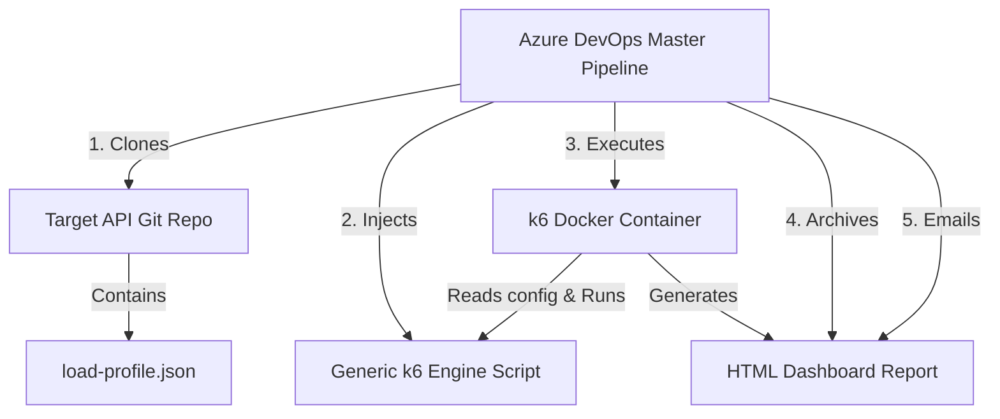

# Master Performance Testing Pipeline

A reusable and dynamic CI/CD performance testing architecture for Azure DevOps leveraging **Grafana k6**.

This architecture separates the **master pipeline execution logic** (this repository) from the **API-specific load configurations** (individual API source code repositories). This allows testing of any API endpoint simply by committing a `load-profile.json` file in that API's repository and triggering this master pipeline.

---

## Architecture Overview



1. **The Master Pipeline Repo (This Repo)**: Contains the Azure DevOps pipeline definition (`azure-pipelines.yml`) and the generic performance engine (`k6-engine-script.js`).
2. **The API Repository**: Contains only a `load-profile.json` file describing its endpoints, methods (including standard verbs and `QUERY`), headers, payload, stages, and thresholds.
3. **Execution**: The pipeline clones the API repo dynamically, injects the generic script, spins up the official `grafana/k6` container, executes the tests, archives the HTML report, and notifies the team.

---

## 1. Setting Up the Target API Repository

To enable stress testing on an API, add a load profile configuration file (e.g., `load-profile.json`) either at the root of its repository or within a dedicated API subdirectory (e.g., `mule-employees-xapi/load-profile.json`).

Organizing testing profiles inside subdirectories allows you to maintain load testing configurations for multiple APIs in a single repository.

The configuration file defines an array of endpoints (`endpoints`) to be executed sequentially by each virtual user during the performance test.

### Option A: Basic Load Profile (Endpoint Collection)
Add this structure for a collection of standard endpoints:
```json
{
  "apiName": "PaymentGateway-StressTest",
  "stages": [
    { "duration": "10s", "target": 5 },
    { "duration": "20s", "target": 10 },
    { "duration": "10s", "target": 0 }
  ],
  "endpoints": [
    {
      "endpoint": "https://httpbin.org/post",
      "method": "POST"
    }
  ]
}
```

### Option B: Advanced Load Profile (Custom Headers, Payloads, and SLAs)
For complex request collections (including GraphQL or API queries using the `QUERY` method), custom headers, pacing/sleep, and custom thresholds (SLAs):
```json
{
  "apiName": "OrderQuery-PerformanceTest",
  "stages": [
    { "duration": "10s", "target": 5 },
    { "duration": "20s", "target": 15 },
    { "duration": "10s", "target": 0 }
  ],
  "thresholds": {
    "http_req_failed": ["rate<0.005"],
    "http_req_duration": ["p(90)<500", "p(95)<1000", "p(99)<2000"]
  },
  "endpoints": [
    {
      "endpoint": "https://httpbin.org/anything",
      "method": "QUERY",
      "headers": {
        "Content-Type": "application/json",
        "Authorization": "Bearer mock-token-12345",
        "X-Client-Id": "stress-test-agent"
      },
      "payload": {
        "query": "query GetActiveOrders($limit: Int) { orders(status: ACTIVE, limit: $limit) { id amount customer { name } } }",
        "variables": {
          "limit": 100
        }
      },
      "expectedStatus": 200,
      "sleepDuration": 0.5
    }
  ]
}
```
```

---

## 2. Using the HTTP `QUERY` Method

The custom HTTP `QUERY` method is fully supported by our generic runner engine. It allows safe, idempotent retrievals that carry a request body (common in complex REST queries and GraphQL setups). 

Our runner uses the underlying `http.request()` in k6 to dynamically route standard HTTP verbs as well as custom ones like `QUERY`:
```javascript
res = http.request('QUERY', url, body, params);
```

---

## 3. Parallel / Batch Execution of Endpoints

By default, the endpoints defined in the collection are executed sequentially (one by one) inside each simulated user's (VU) iteration. If you need to invoke multiple endpoints concurrently in parallel (e.g., to simulate parallel assets download or concurrent REST operations), you can define a `batchGroup` identifier on the endpoints.

Consecutive endpoints sharing the same `batchGroup` value will be executed in parallel using k6's native `http.batch()` API.

### Example Schema (Parallel Execution)
```json
{
  "apiName": "Parallel-Testing-Collection",
  "stages": [
    { "duration": "10s", "target": 5 },
    { "duration": "10s", "target": 0 }
  ],
  "endpoints": [
    {
      "endpoint": "https://httpbin.org/get",
      "method": "GET",
      "batchGroup": "asset-group-1"
    },
    {
      "endpoint": "https://httpbin.org/delay/1",
      "method": "GET",
      "batchGroup": "asset-group-1"
    },
    {
      "endpoint": "https://httpbin.org/post",
      "method": "POST",
      "sleepDuration": 1.0
    }
  ]
}
```
In this scenario:
1. `https://httpbin.org/get` and `https://httpbin.org/delay/1` are triggered **concurrently in parallel**.
2. Once the parallel batch finishes, the runner executes the `POST` request to `https://httpbin.org/post` **sequentially**.

---

## 4. Azure DevOps Pipeline Setup & Reusable Templates

This repository supports two execution models in Azure DevOps:
1. **Imported Mode (Recommended)**: API repositories call this repository as a pipeline template.
2. **Dynamic Manual Mode**: Run manually directly from this master repository by providing a target API URL.

### Method A: Imported Mode (Recommended)
1. In the target API repository, add a `load-profile.json` at the root or under a subdirectory.
2. Copy the sample `templates/azure-pipelines.yml` file and add it to your API repository:
   - It references this repository as a resource named `performance-testing-pipeline-template`.
   - It invokes the reusable job template `k6-pipeline-job-template.yml`.
   - Pass parameters like `apiName` (set to your subdirectory, e.g. `mule-employees-xapi`), `profileName` (e.g. `load-profile-advanced.json`), and `debug` (e.g., `'true'` or `'false'`).
3. Create a pipeline in Azure DevOps pointing to the API repository.

### Method B: Dynamic Manual Mode
1. Create a pipeline in Azure DevOps pointing to this master repository.
2. Choose **Existing Azure Pipelines YAML file** and select [azure-pipelines.yml](file:///e:/MuleCICD/performance-testing-pipeline/azure-pipelines.yml).
3. When triggering the pipeline, fill in:
   - **Target API Git Repo URL**: The Git clone URL of the API repository you want to test.
   - **Email Report Recipient**: The target email address for notifications.
   - **API Name**: The subdirectory name (e.g., `mule-employees-xapi`) if the configuration file is located in a subdirectory. Leave empty if the file is in the root directory.
   - **Profile Name**: The filename of your load profile (e.g., `load-profile-advanced.json`). Defaults to `load-profile.json` if left blank.
   - **Enable HTTP Debugging**: Set to `true` to enable full HTTP debug logs of request and response details in the pipeline logs. (This can also be enabled by setting a variable named `DEBUG` to `true` in your Azure variable group `performance-testing-vg`).

---

## 5. SMTP Email Configuration

The master pipeline utilizes an SMTP email utility ([send-email.py](file:///e:/MuleCICD/performance-testing-pipeline/send-email.py)) to deliver reports.

### Step 1: Create a Variable Group in Azure DevOps
In your Azure DevOps project under **Pipelines -> Library**, create a **Variable Group** named:
`performance-test-smtp-secrets`

### Step 2: Define Secret & Configuration Variables
Add the following variables (mark sensitive ones like `SMTP_PASS` as secret):
- `SMTP_HOST`: The SMTP server host (e.g., `smtp.sendgrid.net`, `smtp.gmail.com`).
- `SMTP_PORT`: The SMTP server port (e.g., `587` or `465`).
- `SMTP_USER`: The username for authentication.
- `SMTP_PASS`: The password, API Key, or token for authentication.
- `SMTP_FROM`: The sender email address (e.g., `perf-alerts@company.com`).
- `SMTP_TLS`: Set to `true` or `ssl` to force implicit SSL/TLS connection (required for Gmail on port `465`).
- `MANDATORY_RECIPIENTS`: A comma-separated list of mandatory email addresses (e.g., `manager1@company.com, manager2@company.com`) where results must always be delivered.

> [!NOTE]
> The template pipeline contains a fallback default for `MANDATORY_RECIPIENTS` in the YAML (`perf-manager@company.com, qa-leads@company.com`). Setting this variable in the Variable Group will override the fallback.
> Whatever recipient list is passed by developers in their `azure-pipelines.yml` will be automatically **appended** to these mandatory email addresses, and the combined list will be **deduplicated** before delivery.

---

## 6. Local Execution & Verification

You can run and test the configuration locally using the provided simulation scripts. The scripts prepare a simulation workspace (`/local-run`) and execute k6 using either **Docker** or **local k6** binary.

### Windows (PowerShell)
Execute the basic configuration:
```powershell
.\run-local.ps1 -ProfileType basic
```
Execute the advanced configuration (testing custom headers and the `QUERY` method):
```powershell
.\run-local.ps1 -ProfileType advanced
```

### Linux / macOS (Bash)
Make the script executable and run:
```bash
chmod +x run-local.sh
./run-local.sh basic
./run-local.sh advanced
```

The script will generate an interactive HTML report dashboard in the folder `./local-run/report.html` which you can open in any browser.
